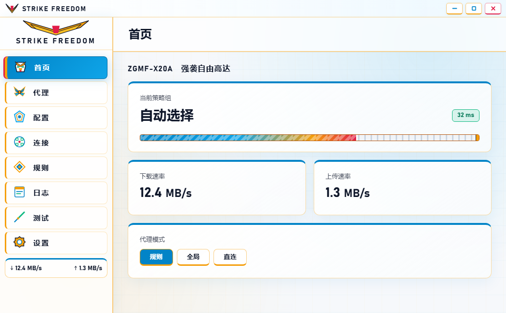
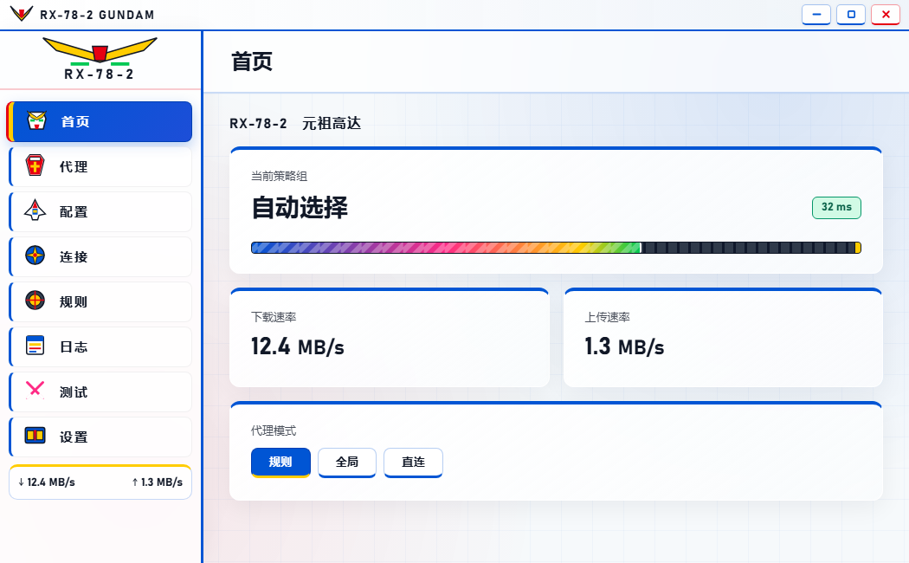
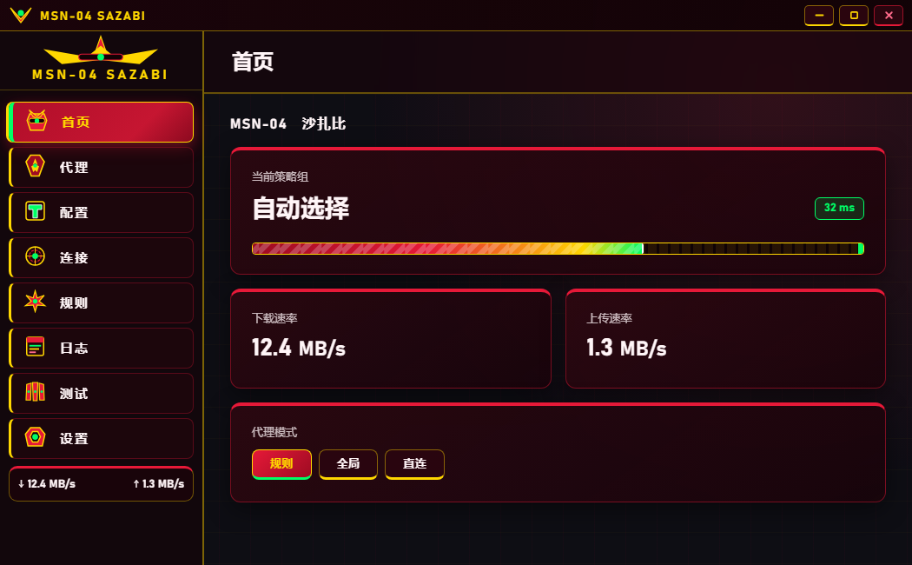
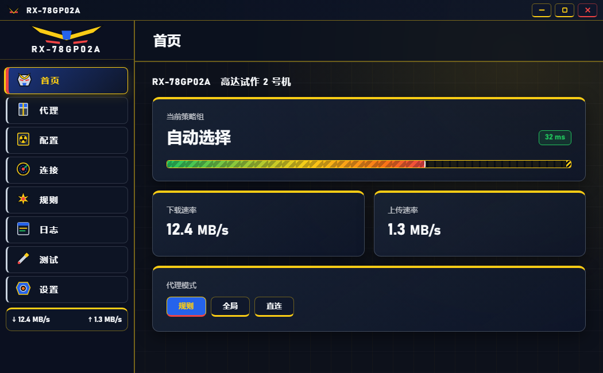

# 🤖 Gundam & EVA Themes for Clash Verge Rev

面向 Clash Verge Rev v2.5.x 界面设计的机甲主题合集。本次收录四套高达主题，主题 CSS 使用 **Gemini Hydrogen** 生成。每个文件都是独立主题，标题栏徽标和导航图标以 SVG 直接嵌入 CSS，无需外部图床。

## 选择主题

| 主题 CSS | 机体 | 推荐模式 | 视觉特色 |
| --- | --- | --- | --- |
| [Strike-Freedom.css](Strike-Freedom.css) | ZGMF-X20A 强袭自由高达 | 浅色 | 珠光白装甲、黄金 V 字天线与蓝金光翼充能条 |
| [RX-78-2-Gundam.css](RX-78-2-Gundam.css) | RX-78-2 元祖高达 | 浅色 | 红黄蓝装甲分色与光束步枪分格充能槽 |
| [MSN-04-Sazabi.css](MSN-04-Sazabi.css) | MSN-04 沙扎比 | 深色 | 绯红与皇家金装甲、翠绿独眼与米加粒子炮充能条 |
| [RX-78GP02A-Physalis.css](RX-78GP02A-Physalis.css) | RX-78GP02A 高达试作 2 号机 | 深色 | 深海军蓝装甲、黑黄警示条与红色双眼 |

## 界面预览

以下图片将各主题的原始 CSS 应用到同一份示例布局，便于比较标题栏、侧栏图标、卡片和充能条。图中使用示例数据，实际布局随客户端版本和系统设置而异。点击图片可查看大图。

| 强袭自由 · 浅色 | 元祖高达 · 浅色 |
| --- | --- |
| [](Strike-Freedom.png) | [](RX-78-2-Gundam.png) |
| **沙扎比 · 深色** | **GP02A 试作 2 号机 · 深色** |
| [](MSN-04-Sazabi.png) | [](RX-78GP02A-Physalis.png) |

## 安装与切换

1. 在上表打开所选 CSS，点击 GitHub 文件页的 **Raw** 并复制完整内容。
2. 打开 Clash Verge Rev 的 **设置**，将 **主题模式** 切换为表中推荐的浅色或深色。若布局设置中提供 **自定义标题栏**，开启后即可显示主题的标题栏样式。
3. 在 **设置 → 主题设置 → 编辑 CSS** 中，先备份已有样式，再粘贴所选主题并保存。切换机体时，用新主题完整替换当前 CSS。
4. 字体可使用系统默认值。若要按本项目推荐的顺序回退，在主题设置的 **Font Family** 中填入以下内容。

```text
"Bahnschrift", "Segoe UI Variable Display", "HarmonyOS Sans SC", "Microsoft YaHei UI", sans-serif
```

恢复默认外观时，清空自定义 CSS 并保存；若之前已有自己的样式，粘贴备份即可。主题使用 Clash Verge Rev 布局类和 Material UI 组件类，客户端更新后，个别组件的外观可能随布局变化。

[Clash Verge Rev 自定义 CSS 文档](https://www.clashverge.dev/guide/css_injection.html)
